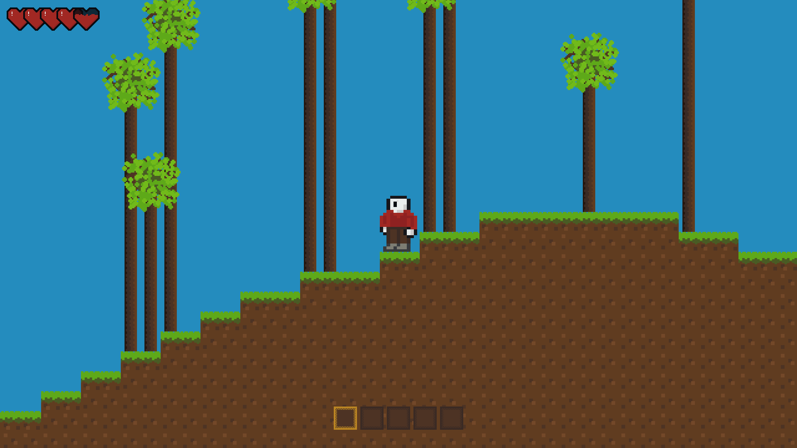

# Terraria-clone

A 2D sandbox survival game (Terraria/Minecraft style) written in **C++20** with **SDL3**.
The codebase is split into a reusable engine layer and a game layer built on top of it.



## Engine

### Core
- **SDL3 callback-based app model** — no `main()`; the game runs through SDL's `SDL_AppInit` / `SDL_AppEvent` / `SDL_AppIterate` / `SDL_AppQuit` callbacks (`main.cpp`).
- **Math & utilities** — lightweight vector types (`vector2f_t`, `vector2_t`) and a hand-rolled multi-octave simplex noise generator (`src/engine/simplex.cpp`).
- **Texture atlas** — a single `resources/tilemap.png` sprite sheet with an id → atlas-coordinate dictionary; blocks, items and UI all render from this one texture.
- **Animation system** — frame-based `AnimatedSprite` (frames/duration) with flipping, used for idle/walk/jump states.
- **Input system** — centralized event handling with per-frame state (keys, mouse, hotbar keys), reset each frame (`include/engine/input.h`).
- **GUI & text** — simple `GuiObject`/`Button` primitives with `std::function` callbacks, plus TTF text rendering for stack counts.

### In the game layer
- **Entity & AABB physics** — entities have position/size/velocity; `DynamicEntity` resolves collisions per-axis against the active block list, so the player and item drops walk, fall and stack correctly.
- **Chunked world streaming** — a 1024×1024 tile world stored as 32×32-block chunks in a hash map; only the chunks within `CHUNK_RADIUS = 2` of the player are activated, rendered and collided each frame.
- **Seeded procedural generation** — multi-octave simplex-noise terrain with grass/dirt/stone strata, random trees, and depth-gated ore veins (coal near the surface, copper deeper down).
- **Mining & building** — blocks have hardness gates and durability with progressive crack overlays; broken blocks spawn physics-simulated item drops that are picked up on proximity.
- **Survival mechanics** — health with heart HUD, 25-slot inventory + 5-slot hotbar with stacking (max 99), and a functional furnace block (fuel + input slots → copper bars).

## Controls

| Input | Action |
|---|---|
| A / D · Space | Move · Jump |
| Left click | Mine / use item |
| 1–5 | Select hotbar slot |
| E | Toggle inventory |
| Right click (furnace) | Open smelting UI |
| F1 / F2 | Zoom out / in (1×–5×) |
| F11 | Fullscreen |

## Building

Requires a C++20 compiler and the SDL3 development libraries:

```sh
sudo apt install libsdl3-dev libsdl3-image-dev libsdl3-ttf-dev   # or your distro's equivalent
```

```sh
make          # builds build/launch_game
make rebuild  # clean + build
```

Run it **from the project root** (assets are loaded via relative paths):

```sh
./build/launch_game
```

## Project layout

```
├── main.cpp            # SDL3 callbacks; wires the game together
├── include/
│   ├── engine/         # math, noise, entities, animation, textures, input, GUI, text
│   └── game/           # world, blocks, player, items, inventory, HUD, furnace
├── src/                # matching .cpp files
├── resources/          # tilemap.png atlas, font, cursor
└── img/                # screenshots
```

